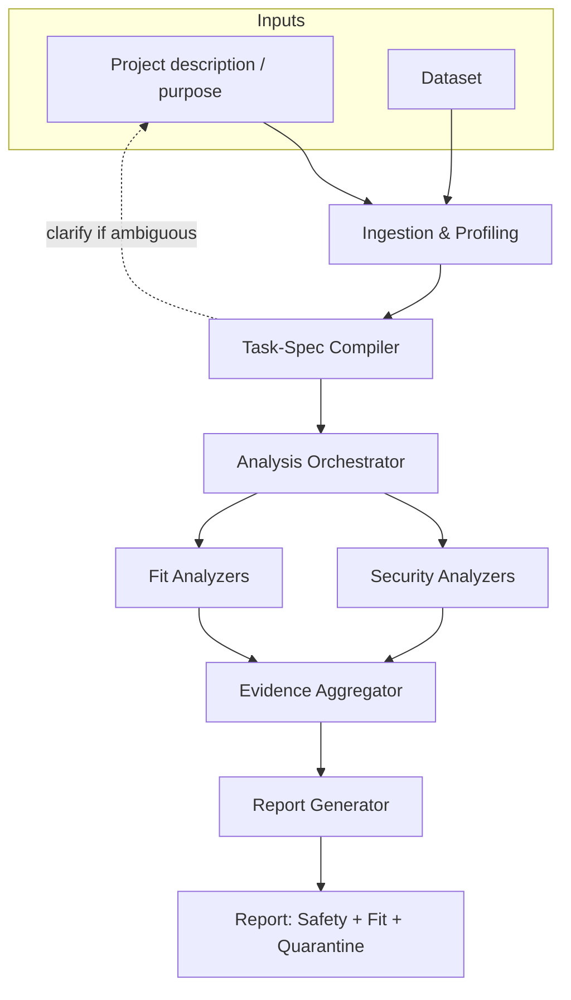

# DataGate — Project Overview & System Design

> Working codename: **DataGate**. A pre-ingestion checkpoint that answers two questions about any dataset *before* you train on it: **Is it safe?** and **Will it actually help my model?**

---

## 1. Problem statement

Teams routinely pull training data from open repositories (Kaggle, Hugging Face, web crawls) or buy it from third parties, then discover *after* an expensive training run — or after a security incident — that the data was mislabeled, duplicated, off-distribution, useless for their goal, or deliberately poisoned. There is no cheap, standard "gate" that vets a dataset for **security** and **task fit** before it enters the pipeline.

DataGate is that gate.

## 2. Two operating modes (one engine, two wrappers)

The core technical insight: both modes run the **same analysis engine**. The difference is the trust environment around it.

**Mode A — Open-Source Checker (PRIMARY, build first).**
The user has already downloaded a dataset (e.g., from Kaggle) and owns their own project. There is *no privacy standoff* — DataGate can see both the data and the user's goal. It runs a **strict** security scan and a **fit** analysis and returns a report. This is the MVP and the reputation-builder.

**Mode B — Trusted Middleman Marketplace (BROADER PLAN, build later).**
A buyer wants to vet a dataset from a seller *before purchase*. Neither party will expose their asset (seller won't reveal raw data pre-payment; buyer won't reveal their model/goal). DataGate sits in the middle as a trusted, audited referee: both sides submit into an isolated environment, the engine runs, and **only the score leaves** — never the raw data. Adds provenance verification, identity checks, payments, and escrow on top of the same engine.

> Sequencing is deliberate. Mode A is fully feasible today. Mode B reuses the engine but drags in an entire marketplace's worth of surface area (payments, disputes, identity, licensing) and, in its strongest form, research-grade cryptography. Ship A, then layer B.

## 3. Goals and non-goals

**Goals**
- Given a dataset + a project description, produce a **Safety score** and a **Fit score**, each with a confidence level and flagged evidence.
- Be **fast and cheap**: give a verdict in minutes without a full training run.
- Be **honest**: output confidence ranges and flagged samples, never absolute guarantees.
- Be **modular**: analyzers are plugins; new data modalities and checks slot in without touching the core.

**Non-goals (explicitly out of scope, and why)**
- We do **not** guarantee data is "100% safe." Poison/backdoor detection is an open research problem; we do strict best-effort detection with a confidence score.
- We do **not** legally *prove* dataset ownership. We verify *provenance* and enforce *accountable identity* — a paper trail, not a math proof.
- We do **not** replace full training. The fit score is a **cheap estimate** of marginal value, not a guarantee of final accuracy.

## 4. The two core checks

### 4.1 Security scan (the "metal detector")
Runs before anything else. Flags and quarantines suspect records. Component checks:
- **Label & quality issues** — mislabeled samples, outliers, corrupt/empty records (confident-learning style).
- **Duplication & benchmark contamination** — near-duplicates within the set and overlap with known public/eval datasets (LSH + embedding similarity).
- **Poisoning / backdoor triggers** — statistical anomalies in embedding/activation space, intra-class distance outliers, trigger-pattern localization. Model-agnostic where possible; no need to train on the suspect data first.
- **PII & sensitive content** — names, emails, secrets, unsafe text.
- **Provenance signals** — is this just a re-upload of a free public dataset? (Mode B especially.)

Output: `safety_score` (0–1), `confidence`, and a `quarantine_list` of flagged sample IDs with reasons.

### 4.2 Fit check (the "taste test")
Estimates whether the data improves *this specific* model/goal — **without** a full training run. Two intuitions combined:

**(a) Gap coverage — does it teach my blind spots?**
Profile where the current model already fails (its errors on a validation set). Embed both those failure cases and the candidate data. Measure how well the candidate data *covers the failure regions* in embedding space. Data that only repeats what the model already handles scores low; data dense in the model's weak spots scores high.

**(b) Directional value — does a small taste steer me toward my goal?**
Learning from data nudges a model in some direction. Take a **small representative sample** of the candidate data and measure the *direction* of the update it induces (via gradients / influence proxies on a held-out target objective). Compare that direction against the direction that reduces loss on the user's actual task. Aligned → good fit. Orthogonal → irrelevant. Opposed → actively harmful.

Optionally, a **tiny proxy model** trained on a sample gives an empirical learnability ceiling.

Output: `fit_score` (0–1), a **predicted marginal-gain range** ("~+2–4% on your task"), a per-dimension breakdown (coverage, alignment, volume adequacy, distribution match), and `confidence`.

> Both scores are **estimates with confidence**, surfaced honestly. The report says "very likely a safe, strong fit," never "guaranteed."

## 5. High-level architecture

**Component responsibilities**

- **Ingestion & Profiling** — load multi-format data (CSV/Parquet/JSON/text/images), infer schema, compute a statistical profile, generate embeddings for text/image content.
- **Task-Spec Compiler** — turn the free-text project description into a structured `ProjectSpec` (task type, modality, target, domain, deployment context, success metric). Asks the user clarifying questions when intent is ambiguous; lets the user edit the parsed spec. *This is the highest-risk component — garbage in here poisons everything downstream.*
- **Analysis Orchestrator** — schedules analyzers, runs them (parallel where possible), handles sampling, GPU jobs, and timeouts.
- **Analyzers (plugins)** — each produces a *scored signal + evidence* for one dimension. Security and fit families share the plugin interface.
- **Evidence Aggregator** — combines analyzer outputs into composite Safety and Fit scores with calibrated confidence. Deterministic and reproducible.
- **Report Generator** — composes a human-readable report **grounded in the evidence numbers**. An LLM may phrase it, but it may never invent a verdict the analyzers didn't support.

## 6. Mode B additions (the middleman layer)

Mode B wraps the same engine with:

- **Isolated per-deal execution** — each evaluation runs in a locked, ephemeral environment; inputs are destroyed after scoring.
- **"Only-the-score-leaves" guarantee** — the buyer receives scores and aggregate evidence, never a copy of the raw data. This alone solves "buyer steals data during the check."
- **Privacy tiers:**
  - *Tier 1 (launch): Trusted escrow.* DataGate is the audited referee; data is encrypted at rest/in transit and access-controlled. Trust is in the platform + audit logs.
  - *Tier 2 (premium): Cryptographic zero-trust.* Secure enclaves or secure multi-party computation so **even DataGate** can't see the contents. Slow, expensive, research-adjacent — a later tier, not v1.
- **Provenance & ownership verification** — dataset fingerprinting/watermarking, dedup against an index of known public datasets, license attestations, and KYC identity verification. Produces "verified provenance," not "proven ownership."
- **Transparency layer** — signed, reproducible reports both sides can trust (process transparency) while contents stay private (content privacy).
- **Marketplace plumbing** — payments with hold/release escrow, dispute resolution, refunds, listings.

## 7. Phased roadmap

- **Phase 0 — Engine + CLI.** The analysis engine as a library and a local command-line tool. Runs Mode A entirely locally. Proves the core science.
- **Phase 1 — Mode A SaaS.** Upload dataset + description → async job → report in the browser. Auth, storage, job queue. *This is the product that earns trust and revenue first.*
- **Phase 2 — Mode B trusted-escrow marketplace.** Buyer/seller accounts, isolated evaluation, provenance + KYC, Stripe escrow, signed reports. Privacy Tier 1.
- **Phase 3 — Mode B zero-trust tier.** Secure enclaves / MPC, verifiable-computation proofs. Premium.

## 8. Data model (sketch)

- `User` — id, identity/KYC status (Mode B), role (buyer/seller/analyst).
- `Dataset` — id, owner, storage_ref, format, profile_summary, fingerprint, provenance_metadata.
- `ProjectSpec` — id, task_type, modality, target, domain, deployment_context, success_metric.
- `AnalysisJob` — id, dataset_ref, spec_ref, mode (A/B), status, created_at.
- `Report` — id, job_ref, safety_score, fit_score, confidence, predicted_gain_range, quarantine_list, evidence[], signature (Mode B).
- `Deal` (Mode B) — id, buyer, seller, dataset_ref, escrow_state, payment_ref.

## 9. API surface (sketch)

- `POST /datasets` — upload or register a dataset (returns a profile summary).
- `POST /specs` — submit/parse a project description into a `ProjectSpec` (may return clarifying questions).
- `POST /analyses` — start an analysis job (dataset + spec + mode). Async.
- `GET /analyses/{id}` — poll status.
- `GET /reports/{id}` — fetch the Safety + Fit report.
- Mode B: `POST /deals`, `POST /deals/{id}/settle`, provenance & identity endpoints.

## 10. Non-functional requirements

- **Performance** — verdict in minutes for typical datasets; heavy work sampled and parallelized; GPU only where needed (embeddings, probe models).
- **Scalability** — stateless API, horizontally scalable async workers, object storage for large files.
- **Security** — encryption at rest and in transit, least-privilege IAM, per-deal isolation (Mode B), append-only audit logs, secrets management.
- **Reproducibility** — deterministic scoring; every report reproducible from stored inputs + versioned analyzer configs.
- **Honesty by design** — all outputs carry confidence; no absolute guarantees in UI copy.
- **Extensibility** — analyzer plugin interface; new modalities/checks without core changes.

## 11. Key risks & mitigations

- **Task-Spec Compiler is fragile.** → Clarification loop + user-editable spec before analysis.
- **Overconfidence destroys trust.** → Calibrated confidence; never assert unsupported verdicts; flag-and-review UX.
- **Security scanner will miss stealthy attacks.** → Market as strict best-effort with confidence, layered defenses, continuous model updates.
- **"Fit from a sample" is an estimate.** → Predicted-gain *ranges*, validated against real training runs over time to calibrate.
- **Mode B scope creep.** → Strict phasing; do not launch the crypto-guaranteed, ownership-proven marketplace on day one.
- **Language matters legally.** → "Verified provenance" not "proven ownership"; "confidence" not "guarantee."

---

*See `02_TECH_STACK.md` for the concrete technology choices and build order.*
